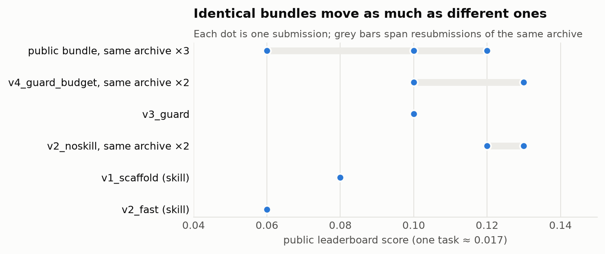
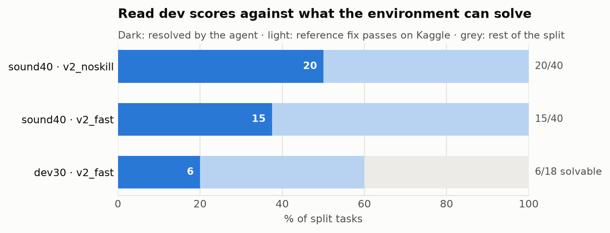
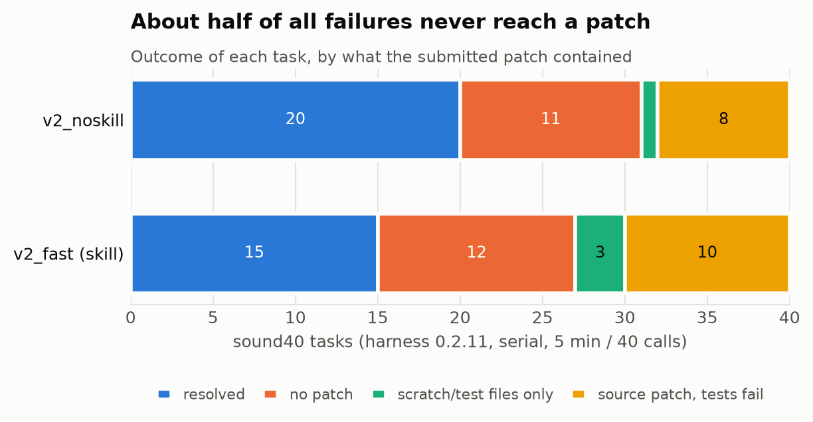

# Audit the Pipeline Before Tuning the Agent
### Measuring a declarative Gemma 4 coding agent under a noisy, hidden leaderboard

<!-- Kaggle Writeup for gemma-4-developer-agent-paper. Limit: 3,000 words, references excluded. -->

## Abstract

The Gemma 4 Developer Agent competition scores a declarative agent bundle (prompts, skills, sampling and budgets for Gemma 4 31B) by how many hidden Python issues it resolves. It does so in a single 12-hour run over private repositories, with one submission a day. We report what one small team learned trying to improve such an agent. Most of it concerns measurement, not the agent.

1. Resubmitting an identical bundle moved its public score by 0.03 (0.13 → 0.10), another team's by up to 0.06: 2–4 of the ~58 leaderboard tasks, as large as most effects we measured. The leaderboard keeps each team's best draw, and scores rise with submission count.
2. The fraction of public tasks that the *reference fix itself* passes depends on the environment: 105/129 in Docker with per-task dependencies, 73/129 in Kaggle notebooks. Raw dev scores are uninterpretable without this ceiling.
3. Reading agent trajectories, not scores, exposed a harness bug. The agent's test-file edits were never reverted before grading, which made correct fixes fail. We replayed it in the harness's Docker sandbox. The organizers fixed it independently six days later.
4. A custom navigation skill that looked neutral-to-positive on early dev tasks coincided with our worst leaderboard scores. A serial, paired run on 40 dev tasks agreed in direction (20 vs 15, p = 0.125; 0.22 on 38 sound ones).
5. Half of all dev failures were agents that never made a source edit, not wrong edits.

We release the toolkit behind these results: a bundle validator encoding scorer pitfalls, per-environment reference-fix ceilings, a "sound" dev split, and a paired comparison tool.

## 1. Introduction

Agent competitions with hidden test sets invite a familiar loop: change the prompt, submit, read the score, repeat. That loop assumes the score is a reliable signal. Here, three properties break it:
- **The test repositories are private.** Public tasks come from four open-source repositories (fastapi, rich, requests, httpx). The ~120 scored tasks come from others.
- **The public leaderboard sees about half of them.** Each submission is a 12-hour GPU run; teams get one a day.
- **The harness is a moving target.** The organizers republished its wheels twice, sometimes under the same version number.

We set out to improve the agent through prompts, custom tools and budget tuning, but our scores never left the 0.06–0.13 band. Measuring why produced findings that transfer to any hidden benchmark.

**Contributions.**
1. A noise model of the public leaderboard, from identical resubmissions and all teams' submission counts.
2. Per-environment reference-fix ceilings, and the "sound split" they enable.
3. A harness-audit method, reading trajectories against harness source, that found a scoring bug with a reproducible replay.
4. Single-factor agent ablations, read against that noise.
5. An open toolkit (Section 6).

## 2. Setting

**Bundle.** A submission is a zip with `agent.yaml` (an ADK agent tree, every agent on `gemma-4-31b-it-qat-w4a16-ct`), prompts, optional skills (instructions plus Python scripts run inside the task sandbox), sampling settings, optional LoRA adapters, and `eval_config.yaml` (per-task limits on time, tool calls, turns and command timeout).

There is no agent code. The harness (`swegemma`/`adk_submission`) compiles the YAML into an ADK agent with fixed tools: `run_command`, `read_file`, `edit_file`, `write_file`, `get_status`, `submit_patch`, and three code-graph tools.

**Scoring.** vLLM serves the model on 4×L4 with a 32k context. Tasks run **sequentially** (host-confirmed). The score is the fraction of tasks whose hidden tests pass on the agent's diff.

**Our compute.** Kaggle only: 45 GPU-hours a week on 4×L4 notebooks. Local work used an M1 Mac with Docker.

**Bundles in this paper.**

| bundle | description |
|---|---|
| `sample` | the official sample: 1 min / 10 tool calls |
| `v1_scaffold` | `swe` navigation skill + red/green workflow prompt, 5 min / 40 calls |
| `v2_fast` | v1 without the red/green steps; first edit by call 6 |
| `v2_noskill` | v2_fast's prompt with shell commands instead of the skill |
| `v3_guard` | v2_noskill + a pre-submit step that reverts test/config edits and deletes scratch files |
| `v4_guard_budget` | v3_guard + Budget-Fit's 8 min / 28 calls / 240 s |
| `v5_budgetfit` | Budget-Fit's public files, unchanged |
| `v7_no_thoughts` | v5_budgetfit with `include_thoughts: false` |

## 3. Measuring under noise

### 3.1 The leaderboard noise floor

| bundle | public scores |
|---|---|
| public bundle (another team, unchanged archive) | 0.12, 0.10, 0.06 |
| `v4_guard_budget` (ours, identical resubmission) | 0.13, 0.10 |
| `v2_noskill` (ours) | 0.13, 0.12 (second on harness 0.2.11) |



With ~58 leaderboard tasks, one task is worth 0.017. A spread of 0.03–0.06 is therefore 2–4 tasks.

All our between-bundle differences fall inside this spread, except `v2_fast` (0.06) against 0.13 (Section 5.1). Our rule: a single leaderboard comparison is never evidence. Leaderboard slots serve to confirm large dev effects and estimate noise.

**The leaderboard rewards submitting often.** It shows each team's *best* score, so every submission is another draw from this spread: a best-of-N effect (cf. [7]). Across all 5,003 teams (2026-11-07 snapshot), scores rise with submission count:

| submissions | teams | mean best score | share ≥ 0.22 |
|---|---|---|---|
| 1 | 927 | 0.089 | 0.0% |
| 3–4 | 934 | 0.128 | 0.2% |
| 10–19 | 918 | 0.167 | 3.4% |
| 20–49 | 419 | 0.183 | 8.8% |

Teams at ≥ 0.22 made a median of 19 submissions; teams at our 0.12–0.13, a median of 3. Effort confounds this, but the strongest public notebooks share one recipe. A participant's census found ten draws of its Budget-Fit files averaging 0.166 (0.13–0.18), about 10 of 58 tasks; another file set scored 7–13 over five draws. The 0.22–0.24 cluster is mostly best draws: Budget-Fit's mean beats ours (7.25) by about 3 tasks, not 7.

### 3.2 Reference-fix ceilings per environment

Before measuring any agent, we ran every public task through the *real harness* with a scripted model that applies the gold patch through `run_command` and calls `submit_patch`. Any task this "oracle" fails is unsolvable in that environment.

| environment | resolved by the reference fix | main causes of failure |
|---|---|---|
| Docker sandbox, per-task dependency set | 105/129 | requests tests need network; rich rendering is version-sensitive |
| Kaggle notebook (subprocess sandbox) | 73/129 | missing test dependencies (35: `inline_snapshot` 27, `dirty_equals` 7, other 1), version differences (13), network (8) |

The Docker number needed extra test-dependency wheels and two fixes. **Package shadowing:** the public wheels include the benchmark repositories, so tests import the *released* package and ignore a correct patch. **Highest-version selection:** the harness keeps each wheel's highest version, pulling an incompatible starlette into older fastapi commits.

Per-task wheel sets that drop the repository's own package and respect its pins raised the oracle from 1/5 to 5/5 on a smoke split.

Our first dev runs scored 5–6 of 30 tasks (17–20%), but only 18 of those 30 are solvable in the Kaggle environment: the agent resolved a third of what it could. We therefore defined the **sound split** `sound40`: 40 tasks, stratified by repository and patch size, drawn only from tasks the reference fix resolves in the Kaggle environment. No `sound40` miss is environmental.



### 3.3 Paired comparison and serial runs

Two variants run on the same tasks agree on most; only *discordant* tasks carry information. We compare runs task by task with an exact McNemar (binomial) test. Our earlier comparison shows why: on 30 tasks, v2_fast resolved every task v1 did plus one (6 vs 5), p = 1.0.

Dev runs must also match the scorer's **sequential** execution: at concurrency 4 every turn is slower, which likely held the official sample's 1-minute budget to 0/30 on dev, against a reported ~0.12.

We then ran `v2_noskill` and `v2_fast` serially on `sound40` with the scorer's budget (5 min, 40 calls), on harness 0.2.11:

| | `v2_fast` resolved | `v2_fast` failed |
|---|---|---|
| **`v2_noskill` resolved** | 14 | 6 |
| **`v2_noskill` failed** | 1 | 19 |

`v2_noskill` resolved 20/40 and `v2_fast` 15/40. Of the 7 discordant tasks, 6 favour `v2_noskill` (exact McNemar p = 0.125). The direction matches the leaderboard (0.13 vs 0.06), but the gap is not significant.

`v2_noskill` also "resolved" `fastapi_14851` without editing any file: its hidden tests pass on the unmodified repository. Replaying an empty patch over all 129 public tasks found one more, `fastapi_14077`, whose hidden test patch only swaps a status constant for its literal value. Both are in `sound40`. A sound task needs two checks: the reference fix passes *and* the empty patch fails. Without both tasks: 18 vs 14 of 38, 5 vs 1 discordant (p = 0.22).

## 4. Auditing the harness

Our most valuable hour came from reading failed trajectories next to the harness source, not from scores.

### 4.1 Test edits made correct fixes fail

In v2_fast's dev run, 3 of 30 tasks failed with `Failed to apply test_patch`. In one of them (`fastapi_14077`), the agent's source edits touched exactly the reference fix's three files. It also changed an assertion in a test that the hidden test patch rewrites.

The harness meant to reset test and configuration files before applying the test patch:

```
git checkout HEAD -- <test files> <agent-touched test/config files> conftest.py pytest.ini sitecustomize.py usercustomize.py _swegemma_stubs.py 2>/dev/null || true
```

The three last paths live in site-packages, never in the repository. Git rejects the *entire* checkout when any pathspec is unknown, and `|| true` hides the error. So the reset never ran.

The outcome depends on the overlap:
- **Test edits on lines the hidden test patch also changes:** the patch fails to apply and the task fails, however correct the fix.
- **Non-overlapping edits:** the test patch still applied, so these edits stayed in the graded tree.

We reproduced it in the harness's local Docker sandbox, replaying `fastapi_14077` with a scripted model:
- the reference fix plus the agent's real test edit: **failed** (`Failed to apply test_patch`);
- the same edits, then a test/config revert: **resolved**.

This task later proved to pass even with an empty patch (Section 3.3). The agent's test edit had turned a free point into a loss.

Our prompt had made things worse. Following the harness README, it told the model "the grader resets test files". The same audit found 3 of v2_fast's 19 patches held only scratch scripts.

`v3_guard` drops the false claim and adds a ship check, a regex-filtered `git checkout` that reverts test/config edits, before `submit_patch`. A unit test runs the prompt's exact command on a scratch repository.

On the leaderboard, `v3_guard` scored 0.10 and its successor 0.13 / 0.10: inside the noise floor. The harness republished on 2026-10-12 (swegemma 0.2.11) fixes the bug upstream. Its reset passes only tracked paths, and protected files are stripped from the agent's patch before scoring. We had documented it independently on 2026-10-06 (repository commit `0dc6bed`).

### 4.2 Other pitfalls a validator can catch

Each of these cost us or other teams a run; the first three are now checks in our validator:
- **Templating.** ADK treats any `{identifier}` in an instruction as a session-state key. A missing key raises `KeyError` at the first model call and fails the task. Only `{problem_description}` and `{hints?}` exist.
- **The 32k request limit.** vLLM rejects prompt + `max_output_tokens` > 32,768, killing long tasks. Keep output at ≤ 8,192 (first noted publicly).
- **The 12-hour cliff.** Exceeding 12 hours errors the whole submission rather than zeroing unfinished tasks. Our check projects 120 × (cap + 1 min setup) and warns.
- **Verification timeout (a null result).** Before 0.2.11, `timeout_seconds` also bounded the scoring pytest run, which a public notebook warned could fail correct patches. Locally, reference-fix scoring pytest took ≤ 9.2 s (mean 1.0 s) on all 129 tasks.
- **History compaction.** At 14,336 prompt tokens, the scorer summarizes all but the agent's last five events, keeping only text: tool outputs and the verbatim issue are lost, at about 25 s each. It fired in 31/40 `sound40` tasks of `v2_noskill` (median call 19). The system instruction, re-sent every turn, survives.

## 5. Agent design under noise

### 5.1 A navigation skill that looked fine on dev

Skills are the only way to ship custom tools in a declarative bundle. Our `swe` skill ranked files for an issue (BM25 plus definition and path bonuses), printed symbol definitions and outlines, ran targeted tests, and checked the patch before submitting.

| bundle | dev30 (Kaggle env, ceiling 18) | public leaderboard |
|---|---|---|
| sample | 0/30* | ~0.12 (public reports) |
| v1_scaffold (skill) | 5/30 | 0.08 |
| v2_fast (skill) | 6/30 | 0.06 |
| v2_noskill (same prompt, shell only) | — | 0.13 |

\* concurrency 4 (Section 3.3).

The skill bundles are our two lowest scores. Removing the skill while keeping the prompt gave our best. Only `v2_fast` clears the 0.06 spread, by one task, and each skill bundle was scored once.

Plausible cause, unproven: the skill's instructions lengthen every request; the model rarely called it (35 calls in 40 `sound40` tasks, 2 in the 6 tasks it lost).

On serial `sound40`, the skill-free bundle won 6 tasks and lost 1 (p = 0.125, Section 3.3). Dev and leaderboard agree in direction; together they suggest, not prove, that on these budgets the custom tool layer cost more than it saved. Both runs hit the time cap on 18 tasks.

### 5.2 Where the points go

Of the 30 v2_fast dev trajectories, 6 resolved and 11 never made a source edit. Of the rest, 3 shipped scratch files only, 3 were blocked by the test-reset bug, 3 hit an environment gap and 4 were wrong fixes (two needed a public name the issue never states).

Fourteen of 30 tasks ended without any source edit; only four were wrong fixes. The resolved tasks first edited source at a median of call 12, about 135 s in, though the prompt asked for an edit by call 6.

The pattern held on `sound40` under 0.2.11, free of environment gaps and the test-reset bug:

| outcome on `sound40` | `v2_noskill` | `v2_fast` |
|---|---|---|
| resolved | 20 | 15 |
| no patch at all | 11 | 12 |
| scratch or test files only | 1 | 3 |
| source patch, hidden tests fail | 8 | 10 |



In both runs, about half the failures produced no patch; nearly all timed out, most while still exploring.

This supports spending budget on *getting to an edit* rather than verification. It matches a public finding that runs without a source edit by call 12 fail 87% of the time. Our 8-minute variant (`v4_guard_budget`) did not separate from the 5-minute one on the leaderboard.

### 5.3 Stripping earlier thinking

`v5_budgetfit` sets `include_thoughts: true`. On harness 0.2.11, `false` drops earlier thinking from the history; the model still thinks. We ran both bundles once, serially, on the 71 sound public tasks (Section 3.3).

With `false`, compaction (Section 4.2) fired in 26/71 tasks instead of 47/71. Mean tokens per model call rose from 317 to 434, though the median stayed at 119: calls of 1,000+ tokens went from 7% to 12%. Tasks running ≥ 8 min went from 10 to 19, and 120 × mean task time, before setup, from 9.1 h to 10.6 h. Resolved tasks fell from 29/71 to 24/71 (9 vs 4 discordant, p = 0.27), not significant: a 40-call variant tied `v5_budgetfit` yet differed on 10 tasks. Plausible cause, unproven: without its earlier reasoning, the model sometimes reasons again at length. We kept the thinking.

## 6. Released resources

The repository (Apache-2.0) contains:
- `g4 validate`: compiles a bundle with the real harness and adds the first three checks of Section 4.2.
- `g4 compare`: paired per-task comparison with an exact McNemar p-value.
- `g4 splits`: frozen, stratified dev splits, including `sound40`.
- `experiments/oracle_kaggle.json`, `oracle_local.json`, `empty_local.json`: per-task reference-fix (Kaggle: with reasons) and empty-patch outcomes.
- Kaggle eval and oracle kernel generators.
- Failure breakdowns, test-reset replay trajectories and harness notes verified against source.
- All bundles of Section 2, the experiment log with bundle hashes, and the leaderboard analysis of Section 3.1.

## 7. Related work

- **SWE-bench** [1] established issue resolution against hidden tests. SWE-bench Verified [5] found many tasks underspecified or unfairly tested. SWE-Bench+ [6] found that a large share of patches counted as resolved leaked the solution or passed weak tests. Our reference-fix ceilings are the environment-side analogue: tasks unsolvable *in a given runtime*.
- **Agent design.** SWE-agent [2] argued the agent-computer interface matters. Agentless [3] showed simple localisation and repair pipelines compete with complex agents. OpenHands [4] provides an open agent platform. Our skill result cautions that a custom tool layer can cost more than it saves.
- **Evaluation noise.** Kapoor et al. [8] call for cost-aware, reproducible agent evaluation. Madaan et al. [9] quantify benchmark variance, including across training seeds. Blum and Hardt [7] analyse adaptive overfitting to competition leaderboards. Dietterich [10] recommends McNemar's test for comparing classifiers.

## 8. Limitations

- **Tiny samples.** Our leaderboard evidence is single or double submissions on ~58 tasks, and our dev evidence is 30–71 tasks with one seed.
- **`sound40` was filtered on the reference fix only.** Two of its tasks pass with an empty patch (Section 3.3). We found them after the runs and report results with and without them.
- **Public repositories differ from the hidden ones:** four well-known open-source projects versus private ones.
- **The harness changed under us** (0.2.7 → 0.2.11), so leaderboard scores before and after 2026-10-12 aren't strictly comparable.

## Acknowledgements

The tooling, experiments and analysis were developed with the help of an AI coding assistant (Claude). Public notebooks by other participants contributed the 32k limit and budget envelope ("Budget-Fit Single Agent"), leaderboard noise ("Measure Before You Tune") and per-draw scores (Dariush Afshar's census; Dmitrii Gluzdov's "Public Agent Ideas and Evidence").

## References

[1] C. E. Jimenez et al. SWE-bench: Can Language Models Resolve Real-World GitHub Issues? ICLR 2024.
[2] J. Yang et al. SWE-agent: Agent-Computer Interfaces Enable Automated Software Engineering. NeurIPS 2024.
[3] C. S. Xia et al. Agentless: Demystifying LLM-based Software Engineering Agents. arXiv:2407.01489, 2024.
[4] X. Wang et al. OpenHands: An Open Platform for AI Software Developers as Generalist Agents. ICLR 2025. arXiv:2407.16741.
[5] N. Chowdhury et al. Introducing SWE-bench Verified. OpenAI, 2024.
[6] R. Aleithan et al. SWE-Bench+: Enhanced Coding Benchmark for LLMs. arXiv:2410.06992, 2024.
[7] A. Blum, M. Hardt. The Ladder: A Reliable Leaderboard for Machine Learning Competitions. ICML 2015.
[8] S. Kapoor et al. AI Agents That Matter. arXiv:2407.01502, 2024.
[9] L. Madaan et al. Quantifying Variance in Evaluation Benchmarks. arXiv:2406.10229, 2024.
[10] T. G. Dietterich. Approximate Statistical Tests for Comparing Supervised Classification Learning Algorithms. Neural Computation 10(7):1895–1923, 1998.
